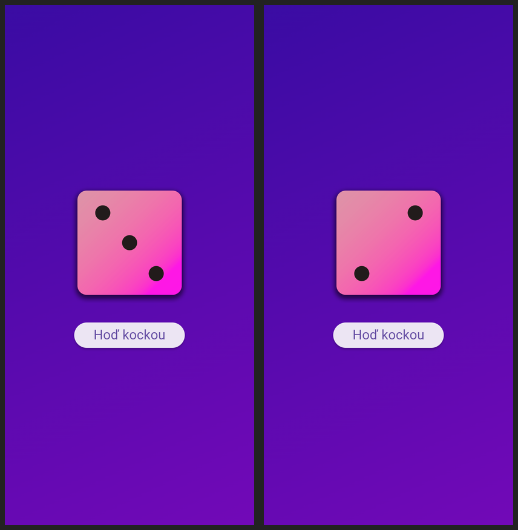

# Roll-the-Dice

Jednoduchá Flutter aplikácia, ktorá po kliknutí na tlačidlo zobrazí náhodnú stranu kocky (1–6).

- obrázky kociek sú lokálne assety v `assets/images/` (registrované v `pubspec.yaml`),
- stav drží `StatefulWidget` (`DiceRoller`) a mení sa cez `setState()`,
- náhodné číslo generuje `Random` z `dart:math` (`nextInt(6) + 1`).

## Spustenie

```
flutter pub get
flutter run
```

## Ukážka


